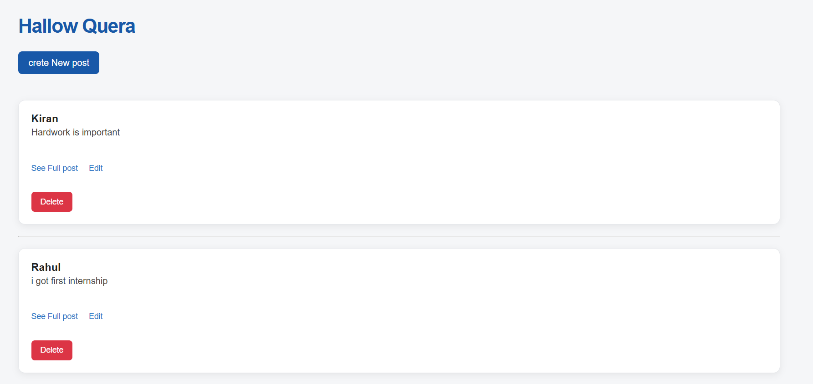

# Express CRUD Post App

A simple post management web application built using **Node.js, Express.js, and EJS**.

This project was created as part of my learning journey while exploring backend development with Node.js and Express.js. It helped me understand how routing, HTTP methods, middleware, and CRUD operations work in a web application.

## Project Screenshot



## Features

- Create a new post
- View all posts
- View individual posts
- Edit existing posts
- Delete posts

## Technologies Used

- Node.js
- Express.js
- EJS
- UUID
- Method-Override
- HTML & CSS

## Installation and Setup

1. Clone this repository:

   ```bash
   git clone YOUR_REPOSITORY_URL
   ```

2. Navigate to the project directory:

   ```bash
   cd Express_CRUD_Post_APP
   ```

3. Install dependencies:

   ```bash
   npm install
   ```

4. Start the server:

   ```bash
   node index.js
   ```

5. Open your browser and visit:

   ```text
   http://localhost:8080/posts
   ```

## Learning Outcomes

While building this project, I learned:

- How to create a server using Express.js.
- How routing works in Express.
- How to implement CRUD operations.
- How to use EJS templates to render dynamic content.
- How to use middleware such as `express.urlencoded()` and `method-override`.
- How to use UUID to generate unique IDs.

## Note

This is a beginner-level project developed during my learning journey. I built it to practice backend development concepts and strengthen my understanding of Node.js and Express.js.

## Author

**Kiran**
